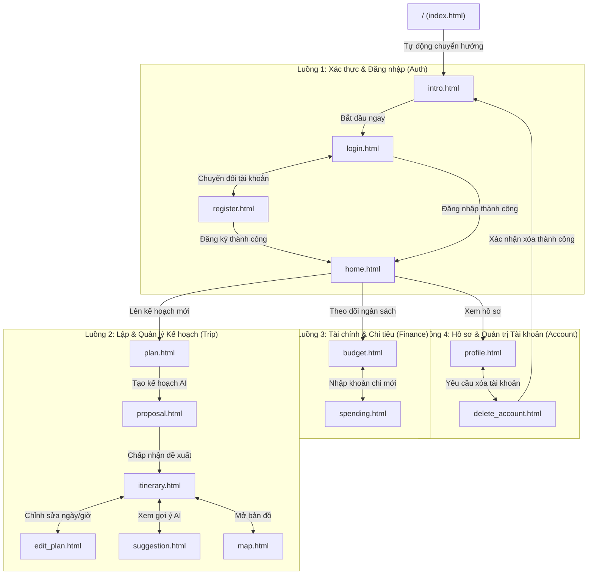

# Tài liệu Kiểm kê Giao diện Người dùng — Frontend UI Inventory (Tuần 1)
**Dự án:** TripWise Mobile-First Application  
**Phiên bản:** Week 1 Milestone Release  
**Kiến trúc:** Vite Multi-Page App (MPA) + 3-Tier Modular CSS + Capacitor Android Hybrid  
**Cập nhật lần cuối:** 20/11/2026  

---

## 1. Tổng quan Kiến trúc Giao diện & Công nghệ

TripWise được thiết kế theo tư duy **Mobile-first** lấy kích thước chuẩn **393x852px** (chuẩn iPhone / Google Pixel hiện đại) làm cơ sở, đồng thời co giãn linh hoạt và bảo đảm không tràn ngang trên các dải màn hình từ hẹp (**360x800px**) đến rộng (**412x915px** và desktop centered shell `430px`).

### 1.1 Ngăn xếp Công nghệ (Frontend Tech Stack)
- **Cốt lõi:** HTML5 Ngữ nghĩa (Semantic HTML5) + Vanilla ES6+ JavaScript.
- **Kiến trúc CSS 3 tầng (3-Tier Modular CSS):**
  - **Tầng 1 (Base):** `src/css/base.css` — CSS Variables `:root`, Modern Reset, Typography Google Fonts, Mobile Container Shell, Android Safe-Area Insets (`env(safe-area-inset-top)`, `env(safe-area-inset-bottom)`), Utility classes.
  - **Tầng 2 (Components):** `src/css/components/` — Web Components độc lập (`<app-header>`, `<app-bottom-bar>`, `<loved-modal>`), Buttons (`button.css`), Form Controls, Popups/Modals (`modal.css`).
  - **Tầng 3 (Pages):** `src/css/pages/` — Style chuyên biệt cho từng màn hình (`auth.css`, `home.css`, `plan.css`, `itinerary.css`, `map.css`, `edit.css`, `budget.css`, `profile.css`).
- **Build & Đóng gói:** Vite Multi-Page Build (`vite.config.js`) ➔ Xuất bản sang `dist/` ➔ Đồng bộ sang nền tảng di động với Capacitor Android (`@capacitor/android`, `@capacitor/cli`).
- **Môi trường dự phòng:** Node.js HTTP Server (`main.js`) + Python Server (`main.py`) + Script khởi động 1-click (`run.bat`).

---

## 2. Bảng Kiểm kê Chi tiết 14 Màn hình (Screen Inventory)

| STT | Tên màn hình | Đường dẫn tệp HTML | Tầng CSS (Tầng 3) | Component dùng chung | CTA Chính & Vùng chạm | Kích thước Touch Target | Trạng thái Safe-Area & 3 Viewport |
| :--- | :--- | :--- | :--- | :--- | :--- | :--- | :--- |
| **1** | Màn hình Khởi đầu | `src/screens/auth/intro.html` | `pages/auth.css` | Nút Button chuẩn | "Bắt đầu ngay" / "Đăng nhập" | `48px` | PASS (360, 393, 412) |
| **2** | Đăng nhập | `src/screens/auth/login.html` | `pages/auth.css` | Button, Eye Toggle | "Đăng nhập" / Google / Facebook | `48px` (nút), `44px` (input/eye) | PASS (360, 393, 412) |
| **3** | Đăng ký | `src/screens/auth/register.html` | `pages/auth.css` | Button, Eye Toggle | "Tạo tài khoản" | `48px` (nút), `44px` (input/eye) | PASS (360, 393, 412) |
| **4** | Trang chủ Khám phá | `src/screens/trip/home.html` | `pages/home.css` | Header, BottomBar, LovedModal | "Lên kế hoạch ngay" | `48px` (nút), `44px` (tabs) | PASS (360, 393, 412) |
| **5** | Lập Kế hoạch Chuyến đi | `src/screens/trip/plan.html` | `pages/plan.css` | Header, BottomBar | "Lập kế hoạch chuyến đi" | `48px` (nút), `44px` (inputs) | PASS (360, 393, 412) |
| **6** | Đề xuất Lịch trình | `src/screens/trip/proposal.html` | `pages/plan.css` | Header, LovedModal | "Chấp nhận lịch trình" | `48px` | PASS (360, 393, 412) |
| **7** | Lịch trình Chi tiết | `src/screens/trip/itinerary.html` | `pages/itinerary.css` | Header, BottomBar, LovedModal | "Xem bản đồ" / "Chỉnh sửa" | `48px` (nút), `44px` (tabs) | PASS (360, 393, 412) |
| **8** | Chỉnh sửa Kế hoạch | `src/screens/trip/edit_plan.html` | `pages/edit.css` | Header, BottomBar | "Lưu thay đổi" | `48px` | PASS (360, 393, 412) |
| **9** | Gợi ý Địa điểm AI | `src/screens/trip/suggestion.html` | `pages/edit.css` | Header, BottomBar, LovedModal | "Thêm vào lịch trình" | `48px` | PASS (360, 393, 412) |
| **10** | Bản đồ Du lịch Trực quan | `src/screens/trip/map.html` | `pages/map.css` | BottomBar, Map FABs, LovedModal | 3 nút nổi FAB (Định vị, Lớp, La bàn) | `44x44px` (FABs), `44px` (tabs) | PASS (360, 393, 412) |
| **11** | Tổng quan Ngân sách | `src/screens/finance/budget.html` | `pages/budget.css` | Header, BottomBar | "Thêm khoản chi" | `48px` (nút), `44px` (tabs) | PASS (360, 393, 412) |
| **12** | Quản lý Chi tiêu | `src/screens/finance/spending.html` | `pages/budget.css` | Header, BottomBar | "Lưu chi tiêu" | `48px` (nút), `44px` (inputs) | PASS (360, 393, 412) |
| **13** | Hồ sơ Cá nhân | `src/screens/account/profile.html` | `pages/profile.css` | Header (Profile), BottomBar | "Chỉnh sửa hồ sơ" / "Xóa tài khoản" | `48px` (nút), `44px` (menu items) | PASS (360, 393, 412) |
| **14** | Xác nhận Xóa Tài khoản | `src/screens/account/delete_account.html` | `pages/profile.css` | Modal Confirm, Buttons | "Xóa tài khoản" (Danger) / "Hủy" | `48px` (nút), `44px` (checkbox) | PASS (360, 393, 412) |

---

## 3. Hệ thống Design Tokens & Nguyên tắc Giao diện

Bảng màu và Typography được bảo toàn chính xác 100% từ thiết kế Figma gốc:

### 3.1 Bảng màu (Color Palette Tokens)
- **Màu nền ứng dụng (Background):** `--bg-app: #FAF8F2` (Màu kem tự nhiên tạo cảm giác nhẹ nhàng, du lịch sinh thái).
- **Màu hành động chính (Primary Brand):** `--primary-emerald: #0B8457` (Xanh ngọc bích sang trọng, dùng cho nút CTA, trạng thái active, thanh tiến trình).
- **Màu hành động khi Hover/Active:** `--primary-hover: #09724A`.
- **Màu chữ chính (Text Main):** `--text-forest: #1E3F20` (Xanh rừng già đậm, độ tương phản cao đạt chuẩn WCAG AA).
- **Màu chữ phụ (Text Secondary / Muted):** `--text-muted: #66745F`.
- **Màu viền & Phân cách (Borders):** `--border-warm: #E5E0D8`.
- **Màu nền thẻ & bề mặt (Card / Surface):** `--bg-surface: #FFFFFF`.
- **Màu trạng thái cảnh báo / nguy hiểm (State Colors):**
  - Cảnh báo (Warning): `--warning-amber: #D97706` (dùng cho badge cảnh báo thời tiết `prop-card-tag.warning`).
  - Nguy hiểm (Danger): `--danger-crimson: #DC2626` (dùng cho nút xóa tài khoản, hành động phá hủy).

### 3.2 Kiểu chữ (Typography)
- **Font giao diện chính:** `Inter`, sans-serif (độ rõ nét cao trên màn hình Retina / OLED).
- **Font tiêu đề nghệ thuật & Điểm đến:** `Playfair Display`, `Cormorant Garamond`, `Luxurious Roman` (Google Fonts).

---

## 4. Thư viện Thành phần Dùng chung (Component Library)

### 4.1 Header (`<app-header>`)
- **Tệp nguồn:** `src/js/components/Header.js`, `src/css/components/header.css`.
- **Variants:**
  - `default`: Hiển thị Avatar người dùng (bấm mở Profile), tên "Linh Nguyễn", dòng chào và chuông thông báo (kèm badge số đếm).
  - `profile`: Dạng tối giản trên màn hình Hồ sơ cá nhân với nút chuông thông báo tròn.
- **Tính năng tương tác:**
  - Bấm chuông mở Popup Thông báo nhanh (Dropdown) hiển thị các thông báo chuyến đi mới nhất.
  - Tự động đóng dropdown khi click ra ngoài hoặc bấm nút Escape.
  - Tự động bù trừ khoảng an toàn `var(--safe-top)` trên tai thỏ / đục lỗ Android.

### 4.2 Bottom Navigation Bar (`<app-bottom-bar>`)
- **Tệp nguồn:** `src/js/components/BottomBar.js`, `src/css/components/bottom-bar.css`.
- **4 Tab điều hướng:**
  1. `Trang chủ`: Trỏ tới `home.html` (Icon Ngôi nhà).
  2. `Lịch trình`: Trỏ tới `itinerary.html` (Icon Lịch trình).
  3. `Bản đồ`: Trỏ tới `map.html` (Icon Bản đồ / La bàn).
  4. `Cá nhân`: Trỏ tới `profile.html` (Icon Người dùng).
- **Tối ưu Mobile:**
  - Bố trí 1 hàng ngang duy nhất (Single Horizontal Row) không ngắt chữ kể cả ở màn hình hẹp `360px`.
  - Cố định sát đáy màn hình kết hợp bù trừ khoảng an toàn `--safe-bottom` (`env(safe-area-inset-bottom, 0px)`).

### 4.3 Modal Yêu thích (`<loved-modal>`)
- **Tệp nguồn:** `src/js/components/LovedModal.js`, `src/css/components/loved-modal.css`.
- **Tính năng:**
  - Hiển thị danh sách các điểm đến / tour du lịch mà người dùng đã bấm lưu (Trái tim).
  - Cho phép xóa nhanh mục khỏi danh sách yêu thích hoặc chuyển thẳng tới chi tiết kế hoạch.
  - Hộp thoại chuẩn kích thước `min(361px, calc(100vw - 24px))`, chiều cao tối đa `85dvh`, cuộn nội dung mượt bên trong.

---

## 5. Bản đồ Điều hướng & Các Luồng Người dùng (Navigation Flow Map)

---

## 6. Ma trận Kiểm thử Responsive 3 Kích thước Màn hình

| Tiêu chí Kiểm định | Viewport Nhỏ (360x800) | Viewport Chuẩn (393x852) | Viewport Lớn (412x915) | Kết luận |
| :--- | :---: | :---: | :---: | :---: |
| **0 Tràn ngang** (`scrollWidth <= innerWidth`) | 14/14 Trang PASS | 14/14 Trang PASS | 14/14 Trang PASS | **ĐẠT 100%** |
| **Bảo toàn Safe Area Top & Bottom** | PASS | PASS | PASS | **ĐẠT 100%** |
| **Vùng chạm CTA & Form Inputs >= 44px** | PASS | PASS | PASS | **ĐẠT 100%** |
| **BottomBar bám sát đáy, không che nội dung** | PASS | PASS | PASS | **ĐẠT 100%** |
| **0 Lỗi 404 hình ảnh / font / CSS / JS** | 0 Lỗi | 0 Lỗi | 0 Lỗi | **ĐẠT 100%** |
| **0 Lỗi JavaScript Console / Uncaught Error** | 0 Lỗi | 0 Lỗi | 0 Lỗi | **ĐẠT 100%** |

---

## 7. Kết luận & Sẵn sàng Bàn giao (Handover Readiness)
Toàn bộ 14 màn hình và các thành phần dùng chung của TripWise Tuần 1 đã được chuẩn hóa theo kiến trúc module sạch, đạt chuẩn 100% về giao diện, bố cục responsive và khả năng tương thích với Capacitor Android. Dự án hoàn toàn sẵn sàng bàn giao cho các tính năng logic nâng cao và tích hợp Backend ở Tuần 2.
